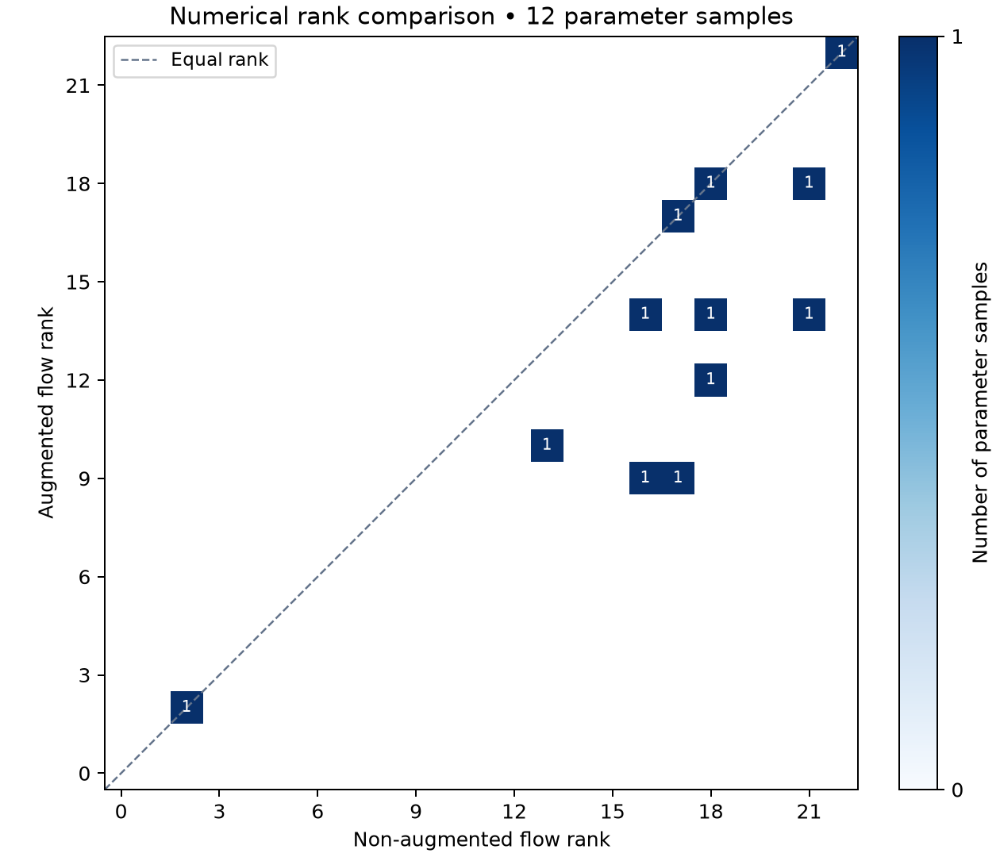
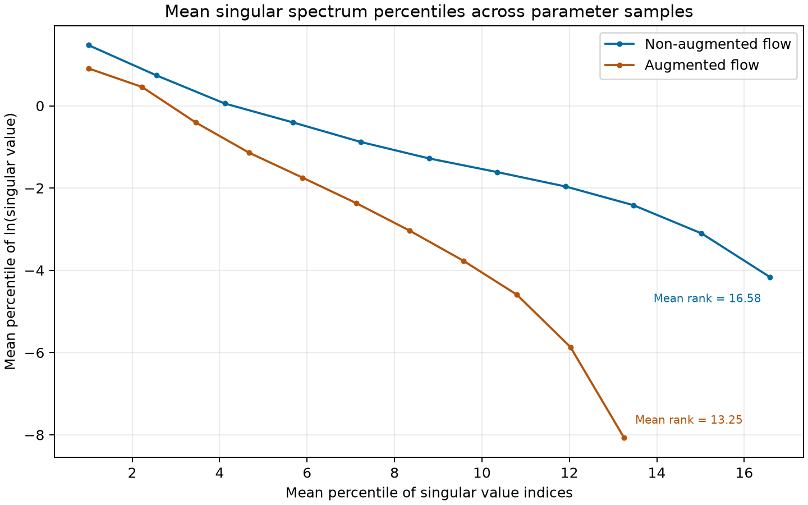

# Neural ODE Jacobian rank experiments

Numerical simulations accompanying the thesis, *Local Parametric Redundancies of ReLU Neural ODEs*. The experiment approximates the parameter derivative of a neural ODE's time-one map by evaluating it on sampled inputs, then studies its singular spectrum and numerical rank across random parameter vectors.

The original neural vector field, sampling distributions, Euler integration, segmented sensitivity equations, and Jacobian normalization are maintained in `rank_simulations/`. Later TOML/CLI configuration, reporting, and visualization tools live separately in `experiment_tools/`. The unchanged supplied script is preserved in [archive/numerical_experiments.py](archive/numerical_experiments.py).

This repository documents previous research work and is maintained as a portfolio project. Active development and ongoing support are not planned.

## Run

Use Python 3.12. Create an environment, activate it, and install dependencies:

```bash
python -m venv .venv
```

Activate with `.\.venv\Scripts\Activate.ps1` in PowerShell, or `source .venv/bin/activate` on Linux/macOS. For a CPU installation:

```bash
python -m pip install torch==2.14.1 --index-url https://download.pytorch.org/whl/cpu
python -m pip install -r requirements.txt
python numerical_experiments.py --config configs/demo.toml
```

The demo uses 12 parameter samples and small CPU settings to illustrate the outputs. It is not a thesis-scale accuracy or convergence result. For CUDA, install the appropriate build using [PyTorch's installation instructions](https://pytorch.org/get-started/locally/); `--device auto` uses CUDA when available. CPU execution uses the same variational method without CUDA graph compilation.





These figures were generated from `configs/demo.toml`: 12 parameter vectors, 64 flow inputs, 128 feedforward inputs, and 20 Euler steps. The corresponding CSV/NPZ files are saved locally in `outputs/demo/`.

The default file [defaults.toml](defaults.toml) retains the original workload: 600 parameter vectors, 40,000 flow input samples, 800,000 feedforward input samples, and 500 Euler steps. Running with no arguments uses these thesis-scale settings:

```bash
python numerical_experiments.py
```

## Settings

Precedence is **defaults.toml < an optional TOML file < explicit CLI flags**. Custom TOML files can specify only the settings they change. All settings are validated before computation. Unknown keys are rejected, and `steps` must be divisible by `segments` so integration reaches the specified terminal time.

```bash
python numerical_experiments.py --config configs/demo.toml --iterations 20 --seed 42 --output-dir outputs/my_run
python numerical_experiments.py --config configs/demo.toml --gelu --no-augmented
python numerical_experiments.py --show-settings
python numerical_experiments.py --help
```

| TOML setting | CLI flag | Meaning |
| --- | --- | --- |
| `n_dim` | `--n-dim` / `--input-dim` | ODE state dimension |
| `depth_val` | `--depth-val` / `--depth` | Number of hidden layers |
| `latent_val` | `--latent-val` / `--latent-dim` | Hidden layer width |
| `rho_val` | `--rho-val` / `--radius` | Radius of the input ball |
| `num_samples` | `--num-samples` | Monte-Carlo samples for each flow Jacobian |
| `num_samples_ff` | `--num-samples-ff` | Monte-Carlo samples for the feedforward rank bound |
| `iterations` | `--iterations` | Number of sampled parameter vectors |
| `t_end` | `--t-end` | Terminal time; 1 gives the time-one map |
| `steps` / `segments` | `--steps` / `--segments` | Euler steps and sensitivity segments |
| `rtol` / `atol` | `--rtol` / `--atol` | Mixed numerical rank tolerances |
| `seed` | `--seed` | Random seed, introduced for reproducibility |
| `device` | `--device auto\|cpu\|cuda` | Execution device |
| `compute_aug` | `--augmented` / `--no-augmented` | Include augmented-input results |
| `compute_gelu` | `--gelu` / `--no-gelu` | Include and export GELU results |
| `compile` | `--compile` / `--no-compile` | CUDA graph compilation on CUDA |
| `plots` | `--plots` / `--no-plots` | Automatically save both figures |
| `output_dir` | `--output-dir` | Output folder, relative to the working directory |

`--compute-aug` and `--compute-gelu` are also accepted, with corresponding negative forms. Boolean CLI overrides can turn TOML settings off. Every run saves a complete `run_settings.toml`, which can be used as `--config` to replay its settings.

## Outputs and figures

Outputs are stored together in the configured directory. Optional GELU outputs go into its `gelu/` subdirectory.

| File | Contents |
| --- | --- |
| `Ranks.csv` | One row per parameter vector: `rank_flow`, `rank_aug` when enabled, and the original `rank_ff` bound |
| `mean_spectrum.csv` | Additional arithmetic mean and population standard deviation at each fixed descending singular index, including zeros |
| `spectra.npz` | All flow/augmented singular spectra and feedforward ranks |
| `plot.csv` | Original 11-point percentile summary: mean indices and mean **natural-log** singular values |
| `rank_histogram.png` | 2D integer-bin histogram of non-augmented versus augmented flow ranks; counts label occupied bins when legible |
| `singular_spectrum.png` | Mean index percentile versus mean natural-log singular value percentile from `plot.csv`; curve endpoints show mean ranks |
| `run_settings.toml` | Complete effective settings |
| `manifest.json` | Settings, actual device/compiler use, versions, code hashes, and run duration |

When augmentation is disabled, the histogram compares flow rank with the feedforward Jacobian rank instead, and the spectrum figure contains only the non-augmented curve.

The spectrum figure uses the original percentile calculation in `plot.csv`. For each parameter vector, retain singular values above the rank tolerance and assign indices `1,...,rank`. At each percentile `p = 0,10,...,100`, compute the `p` percentile of those indices and the `100-p` percentile of the natural-log singular values. Average each coordinate across parameter vectors and plot the resulting 11 pairs. The descending spectrum's right endpoint has x coordinate equal to the **mean numerical rank**, so the figure includes both spectral magnitude and rank information. Each mode uses its own mean index coordinates, with the endpoint labeled explicitly.

The y coordinates are already natural logarithms, so the figure uses a linear y axis and retains negative log values. Zero-rank iterations have no positive log spectrum and are omitted from percentile averaging; when any occur, the endpoint is the mean rank **among the positive-rank iterations**. They remain in the rank histogram and in the additional fixed-index averages in `mean_spectrum.csv`. Entirely zero spectra produce a labeled figure rather than a logarithm error.

Regenerate figures from saved current outputs without recomputing Jacobians:

```bash
python numerical_experiments.py --plot-only outputs/demo
python numerical_experiments.py --plot-only outputs/demo --output-dir outputs/replotted
```

## Numerical method and augmentation convention

The vector field is a fully connected network with ReLU, or optionally GELU, hidden activations. Parameter tensors are sampled uniformly within their original fan-in-dependent bounds. Inputs are sampled uniformly in a ball of radius `rho_val`; the feedforward rank-bound inputs use twice that radius. The same input samples are reused across parameter vectors, as in the supplied script.

Each trajectory is integrated with explicit Euler. Within each segment, the code advances state and parameter sensitivities using derivatives obtained with [PyTorch jacrev](https://docs.pytorch.org/docs/stable/generated/torch.func.jacrev.html) and batches them with [vmap](https://docs.pytorch.org/docs/stable/generated/torch.func.vmap.html). Segment sensitivities are composed using the chain rule. Stacked Jacobian rows are scaled by the square root of domain volume divided by sample count before computing singular values in float64.

**The vector field, state dimension, and parameter vector are held fixed**, while the domain of initial states changes. The non-augmented map uses an `n_dim`-dimensional ball. The augmented map uses an `(n_dim-1)`-dimensional ball embedded by appending a zero coordinate. In the thesis's two-dimensional example this compares a disk with an interval embedded as `(x, 0)`. The fixed output map is the identity, so **all output coordinates are retained**; derivatives are taken only with respect to network parameters. This isolates how restricting the initial-state domain affects parameter redundancy. The numerical integrals use each domain's own volume normalization, so spectral magnitudes also reflect the different measures. See [the exact convention and rank-bound interpretation](docs/THESIS_CONTEXT.md#comparison-convention).

Numerical rank counts singular values greater than `max(atol, rtol * largest_value)`. ReLU spectra are thresholded as in the original script. GELU spectra retain their original unthresholded values; reported GELU ranks apply the same mixed tolerance. Original GELU calculations were discarded by the entry point; they are now exported when requested.

See [thesis context and comparison details](docs/THESIS_CONTEXT.md) for the exact maps, reported observations, and reproduction differences.

## Development and provenance

```bash
python -m pip install -r requirements-dev.txt
python -m pytest -q
python -m ruff check .
python -m ruff format --check .
python -m pip check
```

The tests independently compare segmented sensitivity Jacobians with direct differentiation through the Euler solver for ReLU and GELU. They also cover configuration precedence, invalid settings, fixed-index means, percentile/log coordinates and mean-rank endpoints, zero ranks, GELU export, and figure regeneration. The archived source is excluded from formatting to retain its exact contents.

See [maintenance notes](docs/REFACTORING.md) for preservation decisions.

## License

The code and associated documentation are licensed under the [MIT License](LICENSE).
